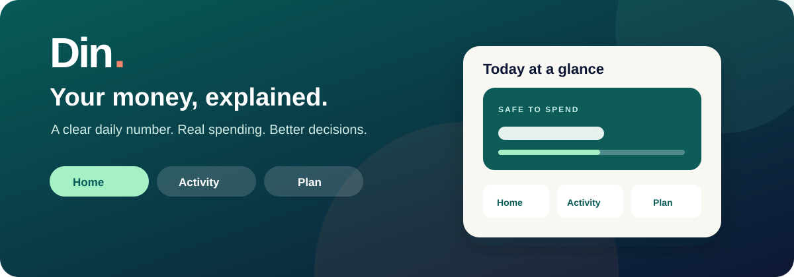

<div align="center">
  

  # Din

  **Your money, explained.** A daily spending tracker built for Android and iPhone.

  [](https://expo.dev/)
  [](https://reactnative.dev/)
  [](#run-on-a-phone)

  
</div>

## What Din does

Din turns a monthly take-home income into a simple daily number. Set aside bills and savings, record spending, and see how much of today's allowance remains. The app starts **empty**—there are no sample transactions or pretend bank connections.

| Home | Activity | Plan |
| --- | --- | --- |
| Daily balance, category totals, monthly recap, top merchants, and possible recurring payments | Add expenses, search, review CSV imports, fix categories, and create merchant rules | Set income, amount to set aside, reminder times, and notification preference |

**Daily allowance:** `(monthly income − monthly set-aside) ÷ 30`

**Remaining today:** `daily allowance − expenses recorded today`

Transfers are excluded from spending totals. Changes to recorded transactions update the dashboard immediately.

## Run on a phone

You need Node.js 22+ and [Expo Go](https://expo.dev/go) on an Android phone or iPhone.

```bash
npm install
npx expo start --tunnel
```

Scan the QR code, then:

1. Open **Plan** and save your monthly income and amount to set aside.
2. Enable phone reminders and grant notification permission if you want morning and evening check-ins.
3. Open **Activity** to add an expense or import a bank CSV.

This repository contains the app source. It does not contain a signed APK or IPA.

## Import real expenses

Din accepts **CSV** files with a date, description, and debit or amount column. It recognizes common headings such as `Transaction Date`, `Narration`, `Particulars`, `Withdrawal Amount`, and `Amount (INR)`. It accepts `DD/MM/YYYY`, `YYYY-MM-DD`, and `DD-MMM-YYYY` dates, and comma or semicolon separators.

```csv
Date,Description,Debit
22/10/2026,Coffee,250
22/10/2026,Groceries,600
```

Use a `Type` or `DR/CR` column to mark credits when importing an amount column. Without a credit marker, positive amounts are treated as expenses; use that layout only for expense-only exports. PDF and Excel workbook imports are not supported.

Before you confirm, Din previews new expenses and flags overlaps with saved transactions. It compares date, amount, and normalized merchant name. Two genuine same-day payments of the same amount can look like duplicates, so review the preview. The exact same file cannot be imported twice.

You can correct a category for one transaction or save a merchant rule for matching entries and future imports. The monthly recap shows category and merchant totals; a merchant seen in at least two months is shown as a **possible** recurring payment, not a confirmed subscription.

## Reminders and data

Din schedules local morning and evening notifications for the next 30 days. They can appear after the app closes. Pending notifications are recalculated when the app opens or recorded data changes. A scheduled recap reflects the expenses known to Din at scheduling time; it cannot include an unrecorded purchase. Device settings may delay notifications.

Transactions are stored locally with Expo SQLite. This prototype has no app-level database encryption, backup, account login, or production security review. Avoid treating it as a production financial vault.

## Current integration status

| Capability | Status |
| --- | --- |
| Manual spending and CSV import | Working |
| Daily budget and spending analysis | Working with recorded data |
| Local phone reminders | Implemented; test delivery on your devices |
| Automatic bank/UPI sync | **Not connected** |
| Store-ready signed app | **Not built** |

Automatic bank data in India needs an eligible Financial Information User or partner, an Account Aggregator provider, consent handling, and a secure backend. The app does not request bank credentials or claim to sync accounts today.

## Development

```bash
node --experimental-strip-types src/finance.test.mjs
npx tsc --noEmit
npx expo export --platform android
npx expo export --platform ios
```

`app/` contains the three routes and add-expense screen. `src/finance.ts` contains budget, import, duplicate, and recap logic. `src/store.tsx` persists data; `src/reminders.ts` schedules notifications.

## Next steps

- Test notifications and import flows on physical Android and iPhone devices.
- Add encrypted backup and an app lock before wider use.
- Integrate consent-based bank data only after the required partner and backend are in place.
